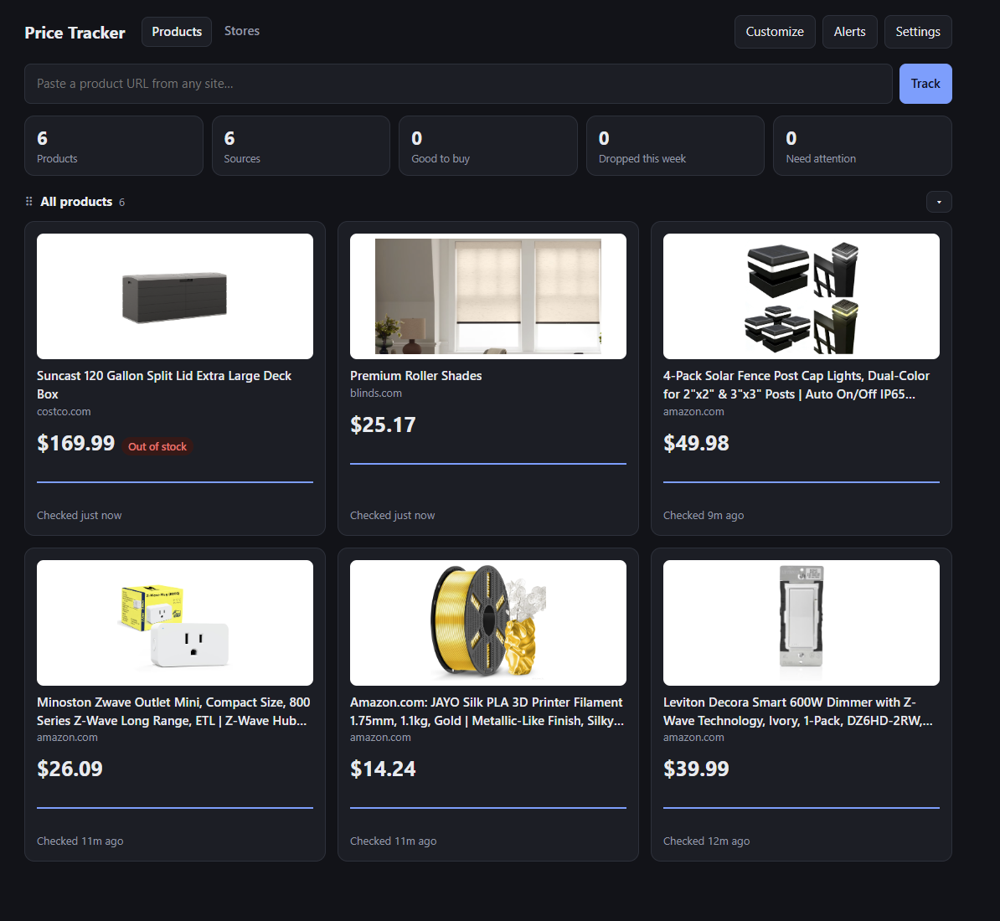

# Price Tracker

Self-hosted price tracker. Paste a product URL from any site; it records the price, re-checks on a schedule, charts the history, and alerts you on drops. Feature set modelled on [PriceBuddy](https://pricebuddy.jez.me/features.html), in a single container with SQLite.



## Install

```bash
docker compose up -d
```

This pulls the image published by GitHub Actions (`ghcr.io/tet0r/price-tracker`, amd64 and arm64). To build from source instead, run `docker compose up -d --build`. Update later with `docker compose pull && docker compose up -d`.

Open http://localhost:8080. Data lives in `./data/tracker.db` — back up that folder.

## Updating

```bash
docker compose pull && docker compose up -d
```

The running version is shown at the bottom of the page. Twice a day the app asks GitHub whether a newer release exists; when one does you get a banner, an in-app alert, and a message on Discord / your Apprise services. Set `UPDATE_CHECK: "false"` to turn this off. To stay on a specific release, use an image tag such as `ghcr.io/tet0r/price-tracker:1.0.0` instead of `:latest`.

Releases are cut by changing the number in the `VERSION` file: the first push to `main` with a new number publishes that image tag and a GitHub release.

## Features

- **Any store** — paste a URL and the price, title, image and availability are auto-detected. A *store* (per-domain scraping config) is created automatically.
- **Product pictures** — the product photo is taken from the store page and a copy is kept in `./data/images`, so it still shows when a shop blocks hotlinking.
- **Compare stores** — add several URLs to one product; the cheapest buyable source is the product's price.
- **Unit pricing** — give each source a pack size and the product a unit name to compare by price per tablet, bag, litre, etc.
- **Availability** — in stock, pre-order, back order, out of stock, discontinued. Out-of-stock sources don't count as the best price.
- **Price history** — step chart per source, with lowest / highest / time-weighted average.
- **Scheduling** — per-product check frequency from 5 minutes to 24 hours, or pause a product.
- **Alerts** — target price, price drops (optionally only above a % threshold), back in stock. Shown in-app, posted to Discord, and sent via any [Apprise URL](https://github.com/caronc/apprise/wiki) (ntfy, Telegram, Gotify, Pushover, Slack, email, …).
- **Customisable dashboard** — products grouped by tag. Drag groups and products to reorder, drag a product to another group to re-tag it, collapse groups. **Customize** shows or hides the summary stats and the *Good to buy now*, *Recently dropped* and *Needs attention* sections.
- **Product search** — with a SearXNG instance, type a product name instead of a URL, or find a product at other stores.
- **AI-assisted scraping** (optional) — recover a price the rules miss, or have AI propose a store's rules.
- **JavaScript sites** — falls back to headless Chromium when a plain HTTP request is blocked or finds no price.
- **Duplicate detection** — tracking parameters (`utm_*`, `gclid`, `fbclid`, Amazon `ref`, …) are ignored when matching URLs.

## Stores

If a site shows the wrong price or none, open **Stores → Edit** and set a strategy per field (title, price, image, availability):

| Strategy | Value |
|---|---|
| Auto | schema.org JSON-LD → meta tags → common price elements |
| Schema.org | JSON-LD only |
| CSS selector | `.price`, or `meta[property="og:price:amount"]\|content` to read an attribute |
| Regex | First capture group, run on the raw page, e.g. `"price":\s*"(.*?)"` |
| JSON path | Dot path into a JSON response, e.g. `product.variants.0.price` |

Also per store: currency, fetch method (auto / HTTP / headless browser), cookies to send, and *treat a missing price as out of stock*. Use **Test** to try a config against a URL before saving.

## Discord notifications

In Discord, open the channel's settings → **Integrations → Webhooks → New Webhook → Copy Webhook URL**. Paste it under **Settings → Discord webhook URL** and click **Send test notification**. Price drops, target prices reached and back-in-stock alerts are then posted to that channel with the product image and a link to the cheapest store. Which alerts fire is set per product (target price, minimum drop %, back in stock).

## Product search (SearXNG)

Set your SearXNG address under **Settings → Product search** (or `SEARXNG_URL`). The instance must allow JSON output — in its `settings.yml`:

```yaml
search:
  formats: [html, json]
```

## AI-assisted scraping

Off by default. Under **Settings → AI-assisted scraping** choose Anthropic, OpenAI, Gemini or a local Ollama, and give a model and API key (the key can also come from `AI_API_KEY`). Then, per store:

- **Let AI read the price when these rules find none** — only fills a gap: it never overrides a scraped price, is skipped for out-of-stock pages, and only a confident answer is accepted.
- **Suggest rules with AI** — proposes CSS selectors from a product URL, shows what they extract, and saves nothing until you click Save.

The page's HTML (scripts and styling removed) is sent to the provider you choose. Pages over 150,000 characters after cleaning are cut to that length.

## Configuration (`docker-compose.yml`)

| Variable | Default | |
|---|---|---|
| `CHECK_INTERVAL_MINUTES` | `360` | Default frequency for new products |
| `USE_BROWSER` | `true` | Headless Chromium fallback. `false` saves RAM but breaks JS-heavy sites |
| `AUTH_USERNAME` / `AUTH_PASSWORD` | `admin` / empty | Set a password to require a login (HTTP basic auth) |
| `ALLOW_PRIVATE_URLS` | `false` | Allow product URLs on private addresses (your LAN, localhost). Picture downloads are always limited to public addresses |
| `UPDATE_CHECK` | `true` | Check GitHub for a newer release twice a day. `false` makes no outside calls for this |
| `SEARXNG_URL` | empty | SearXNG address, if not set in Settings |
| `AI_API_KEY` | empty | AI provider key, if not set in Settings |

## Notes

- With no `AUTH_PASSWORD` there is no login, and anyone who can reach the port has full control. Set one, and use HTTPS via a reverse proxy if it's reachable from outside your network.
- The app runs as an unprivileged user inside the container and refuses to fetch private network addresses unless `ALLOW_PRIVATE_URLS` is on. Saved secrets (webhooks, notification URLs, store cookies, AI key) are never sent back to the browser in full.
- Some sites (Amazon in particular) serve CAPTCHAs to automated requests; checks against them fail intermittently.
- Prices are stored without a currency and shown in the store's currency. Mixing currencies in one product gives wrong comparisons.
- With unit pricing in use, a product's price, target and alerts are all per unit.
- Dragging on the dashboard needs a mouse; it doesn't work on touch screens.
- Single user: there are no separate accounts.

## License

[MIT](LICENSE)
